# Diagrams of gov-tla, a TLA+ model of the procedural core of the United States Constitution

Seven generated SVG diagrams of the gov-tla corpus: the modules, their row lists, their results files and the
README that describes them. They have clickable links, adapt to light and dark, and are meant to be opened on
their own and zoomed, or printed at poster scale.

A diagram is a derived artifact. It describes the records and never decides anything. **Where a diagram and a
record disagree, the record wins.** None of it is a claim about law or practice.

Nothing here runs TLC or TLAPS. The counts and verdicts are read at build time from the results files the
repository's scripts generated, and a build fails when a file no longer parses or no longer agrees with what a
diagram checks.

## The diagrams

**Start here.**
- [A1](gov-tla/A1-evidence-chain-2026.11.25.svg) for the corpus on one page, and how each count is made
- [B6](gov-tla/B6-senate-rules-2026.11.25.svg) for the smallest module, read whole
- [B1](gov-tla/B1-constitution-2026.11.25.svg) for legislation, the Executive and Article V
- [B4](gov-tla/B4-government-2026.11.25.svg) for what is proved, checked, sampled and refuted, side by side
- [B5](gov-tla/B5-elections-2026.11.25.svg) for the one liveness property that is proved

Two families; the table below names each diagram.

- The corpus and its evidence: [A1](gov-tla/A1-evidence-chain-2026.11.25.svg)
- One diagram per module: [B1](gov-tla/B1-constitution-2026.11.25.svg) `Constitution.tla`,
  [B2](gov-tla/B2-judiciary-2026.11.25.svg) `Judiciary.tla`,
  [B3](gov-tla/B3-executive-2026.11.25.svg) `Executive.tla`,
  [B4](gov-tla/B4-government-2026.11.25.svg) `Government.tla`,
  [B5](gov-tla/B5-elections-2026.11.25.svg) `Elections.tla`,
  [B6](gov-tla/B6-senate-rules-2026.11.25.svg) `SenateRules.tla`

[](gov-tla/A1-evidence-chain-2026.11.25.svg)

| Id | Diagram | What it shows |
|---|---|---|
| A1 | [How every count in the README is made](gov-tla/A1-evidence-chain-2026.11.25.svg) | The pipeline from a module to its two results files (generators that write, audits that only read), the method's five rules, the README's summary table drawn whole beside the same counts read from the twelve named results files, every TLC row by kind and verdict, what is not proved, and the flip tests' two records side by side. **Builds only if** every README count equals its results file's, each named file is the newest of its kind, and every digest matches the current specs. |
| B1 | [Constitution.tla: legislation, the Executive and Article V](gov-tla/B1-constitution-2026.11.25.svg) | The three machines over one Executive and one sitting of Congress, each with numbered action arrows and a key of guards, mutations and flags; the thirteen properties as the header states them; how each row switches on only the machine its property reads, with the inert cells checked against state counts; the README's provisions and mutation tables whole beside the header, the Expected: line, the counterexamples and the proof hypotheses; the 20 × 15 matrix with distinct states; 14 witnesses; the liveness and deadlock rows; 14 theorems with their hypotheses; the README's findings and the session-gate finding. |
| B2 | [Judiciary.tla: one Supreme Court, the courts Congress makes, their judges and their cases](gov-tla/B2-judiciary-2026.11.25.svg) | Congress, judges, courts and cases with seven numbered arrows and the guard each mutation removes; the four flags; the README's provisions and mutation tables whole beside the header, the rows comments, the counterexamples and the proof hypotheses (`M_REESTABLISH` drawn red: the header omits `BenchFitsSeats`); the judge-side and case-side profiles; the 24 × 20 matrix with distinct states; witnesses; the two deadlock rows (no liveness); 21 theorems, 23 mutation lemmas; what TLC found in the earlier text. |
| B3 | [Executive.tla: Article II and the administrative state](gov-tla/B3-executive-2026.11.25.svg) | Three machines over one President, one Congress and the agencies it charters: the Amendment XXV inability machine (arrows ①–⑧ with a key); agencies from the six `KnownCharters` (the three `Chartered` checks evaluated at build time), head appointment, three removals and the FVRA acting chain; eligibility, impeachment, pardon, treaties, war and sessions. The README's provisions and mutation tables whole beside the header, the Expected: line, the counterexamples and the proof hypotheses; the matrix over 14 properties; 19 witnesses; the liveness rows (`ActingEventuallyEnds`: checked, not proved); 14 theorems with their hypotheses. |
| B4 | [Government.tla: the authority graph](gov-tla/B4-government-2026.11.25.svg) | The grant layer read from the module's edge sets (`Founding`, `Adds`, `Drops`, `AgencyEdges`, `CourtEdges`), nodes in `Rank` order, the edges that run back drawn below; the control layer as a holder × target table; every edge and every action of `Next` as the module writes them; the README's claims and mutation tables whole, joined to theorems and rows; the configurations; the mutation × configuration matrix; witnesses; the liveness rows (`UnconstitutionalEdgesAreStruck`: checked, not proved); the five `Reach` claims checked, not proved, their local forms proved; the one sampled row drawn sampled; 27 theorems; the claim TLC **refuted**, with its trace; one band from `SESSION-GATE-FINDINGS-2026.11.17.md` § 5. |
| B5 | [Elections.tla: the presidential cycle](gov-tla/B5-elections-2026.11.25.svg) | The `stage` and `clock` lanes, and who acts at each stage with the guard each mutation removes (ten numbered arrows and a key); the README's provisions and mutation tables whole beside the header and the counterexamples; the matrix with one line per mutation and set of constants (529 rows on `Spec`); 24 witnesses; the liveness rows, with `ExecutiveIsFilled` **proved** by one WF1 step; 22 theorems with their hypotheses; the 24 `Mut…Admits` lemmas, inside the module and proved (until PR #16 they followed the module's first end-of-module line, and the diagram drew them red); `Elections.cfg` beside `c-cfg-safety`; one band from `MUTATION-MATRIX-FINDINGS-2026.11.17.md`. |
| B6 | [SenateRules.tla: the filibuster](gov-tla/B6-senate-rules-2026.11.25.svg) | The floor (stages, numbered steps) and each kind's cloture threshold, which only falls; the vote ladder at seven and five Senators (the diagram's arithmetic, checked against the operators at build time); the README's rule and mutation tables whole beside the module header; the mutation × property matrix with the seven- and five-Senator rows apart; the eight witnesses; the temporal rows (`MajorityPrevails`, `ReconciliationPrevails`, `NoBehaviour`: checked, not proved); the seven theorems with their hypotheses; why there are two TLC results files dated 2026.11.19. |

A release is a version tag; each one carries every diagram as a file, with checksums and the pins it was drawn
from, so a diagram can be cited by release and fetched after the tree has moved on: see
[the releases](https://github.com/scottcochran/gov-tla/releases). One release at a time is served at
<https://scottcochran.github.io/gov-tla/>, where a diagram opens as an SVG with its links and its style.
**GitHub's file viewer shows an SVG as an image, without its links or its style**, and so does the embed above.

## Where the content comes from

The corpus is the tracked tree of this repository at one commit, the state of record: the diagrams are drawn
against `main` at `d3c9aed` (2026.11.20), tracked files only. The records are the modules and proof modules in
`specs/`, the row lists in `rows/`, the results files in `results/`, the root README, the findings in `docs/` and
`PROOF-GAPS.txt`. Every statement on a diagram traces to one of them, cited on the card or in the table, and each
diagram's footer lists its sources. Untracked files are not records and are never drawn from.

Counts, verdicts, mutation-by-property matrices, theorems and their hypotheses are read at build time through
[`gov-tla/src/corpus.py`](gov-tla/src/corpus.py), so they are the files' and not copied numbers. The results file
each module's diagram reads is named in `corpus.RESULTS`, never chosen as the newest: a new results file changes no
diagram until `corpus.RESULTS` names it, and A1 fails to build until it does.

Where a record has a table, the diagram draws all of it: every row and every column. Where two records disagree (a
README table and a results file, a module header and the README), the diagram draws what each says, marks the
disagreement red, and does not reconcile them. A cross-reference the records do not make is headed as the diagram's
own, and a number no record states is labelled illustrative.

The statuses are the README's words: *checked*, *proved*, *sampled* and *refuted*, with *checked, not proved* for
liveness and `Reach` claims. A liveness property, a global `Reach` claim or a witness is never drawn as proved, and
a sampled row is never drawn as checked.

**Drawn 2026.11.25**: seven diagrams, A1 by hand and B1–B6 by six drawing agents in parallel, one per module, each reviewed in both themes and its reported inconsistencies checked against the files. Drawing surfaced ten verified findings and seven unchecked leads, none of which changes a verdict: see [FINDINGS-2026.11.25.md](FINDINGS-2026.11.25.md). No record was changed to match a diagram.

**Amended 2026.11.25** for the Elections proof fix (PR #16, `a6e724e`; [`docs/ELECTIONS-PROOF-TERMINATOR-FINDINGS-2026.11.25.md`](../docs/ELECTIONS-PROOF-TERMINATOR-FINDINGS-2026.11.25.md)). `Elections_proof.tla` now ends after its 24 mutation lemmas, and `results/Elections-proof-results-2026.11.26.txt` proves 1,145 obligations. `corpus.RESULTS` names that file, and two diagrams are amended against `a6e724e`: their footers say so, and their links out open that commit (`corpus.PIN_ELECTIONS_FIX`). **A1** counts 1,145 for Elections and 6,965 in all. **B5** draws the lemmas inside the module and proved. B1–B4 and B6 read nothing that changed, and were deliberately not amended: they regenerate byte for byte, and keep `d3c9aed`. Finding 1 of [FINDINGS-2026.11.25.md](FINDINGS-2026.11.25.md) is marked fixed.

## What is checked

The diagrams are a second reading of the records, and the generator is strict about it. Every reader in
`corpus.py` and in a diagram's module parses strictly and raises on a shape it does not expect, so the generator
prints `ERROR` and the build fails, the way a gate fails. A1 is the gate for the corpus as a whole.

| Diagram | What must hold, or the build fails |
|---|---|
| A1 | every count in the README's summary table equals the count read from the module's named results files; each named results file is the newest committed one of its kind (the rule of `scripts/compare_results.py`); every digest on a results file's `Modules:` line is the sha256 of that file in `specs/` now, and its `Rows:` digest that of the row list; each proof results file names the module's TLC results file by its sha256; every TLC row is as expected, and of a kind and verdict the table draws |
| B1 | the README section parses in the shape drawn (its two tables, the Abstracted and Safety paragraphs, the witness list, the Liveness and Rows paragraphs); the module header's `MUTATIONS` list gives a "Breaks" clause for each mutation, and the thirteen properties are those of the module's `Safety`; the rows header's sentence on inert cells reads as drawn |
| B2 | the results files, the README section (both tables, Abstracted, the witness list, Rows), the module header (`PROPERTIES`, `MUTATIONS`, `WITNESSES`, `ABSTRACTED`, `LIVENESS`), the row list's section comments and the proof module's `Inv…` definitions and `Mut…` lemmas all parse in the shape drawn |
| B3 | every row is as expected; the results files' digests are those of `specs/` and `rows/` now, and the proof results file names the TLC results file by its sha256; the README section's tables and lists parse in the shape drawn; the module header and the `Expected:` line name a broken property for every mutation the results file runs; `KnownCharters` holds six charter records of the shape drawn |
| B4 | the named results files are the newest of their kind, with the digests of `specs/` and the row list now, and every row as expected; every row's configuration, from its name, matches its constants, `constraint=LawRowsBound` is on exactly the `a-` rows, and every row falls in exactly one band drawn; the module's edge sets, `Rank`, `Fixed`, `Challengeable`, `IsInert` and the `Fire(…)` argument of every action parse, and `Next` names exactly the actions drawn; in the README section, every local form has a theorem and no global form has one; `SESSION-GATE-FINDINGS-2026.11.17.md` § 5 and the two spec lines it cites read as drawn |
| B5 | the results files, the README section and its findings, the module header's `MUTATIONS`, its `Stages` and `Clocks`, the `CONSTANTS` of `Elections.cfg` and the row list's `# const:` block all parse in the shape drawn |
| B6 | every row is as expected and none is sampled; the README summary table's `SenateRules` counts equal those read from the results files; the results files' digests are those of the files in the tree now, and the proof results file names the TLC results file by its sha256; the README section parses in the shape drawn; the witnesses the module header names are the witness rows of the results file; the threshold operators drawn as arithmetic are defined in the module as drawn |

A disagreement between two records is not a failure of the build. It is drawn, as above, and reported in
[FINDINGS-2026.11.25.md](FINDINGS-2026.11.25.md).

The generator also prints a `WARNING`, which CI and the regression check treat as a failure, if:

- two lines of text overlap, a line leaves the canvas, or two cards or tables overlap without one holding the
  other;
- an `id` is drawn twice on one diagram;
- a link names an anchor its diagram does not draw, a diagram the manifest does not list, an anchor the manifest
  does not list for that diagram, or another diagram with no anchor at all;
- a link out is not to a file of this repository at the diagram's pinned commit;
- link markup is left as text in an output.

And it prints a `NOTE` and exits 1 when a diagram's anchors moved and the committed manifest was stale (see
Links, below).

## The diagrams in detail

Each B diagram opens with a status strip: the module with its TLC status (rows, all as expected), its proof status
(obligations, all proved) and what is checked but not proved. Below it are the module's machines as a picture, the
README's tables whole beside the module header, the mutation × property matrix, the witnesses, the liveness and
deadlock rows, the theorems with their hypotheses, and the findings.

The colours mean the same on every diagram: blue is proved, and the text as written (`Mut = "none"`); teal the
mechanism, and checked; green a witness; amber checked, not proved; violet a mutation; red a counterexample, a gap
or a refuted claim; brown the People, the States and electors; pink a finding; grey what is abstracted, external
or sampled. A solid arrow carries authority or data. A dashed arrow is a removal, a denial, or a path that only
removes authority: a veto, a removal, a court striking a law.

Each diagram adapts to light and dark themes (`prefers-color-scheme`; renderers without CSS fall back to light).
In the light theme the page behind the cards is a grey matched to the mean luminance of the content, `#ececec`, as
in riemann-diagrams; [PAGE.md](PAGE.md) records how that was measured and how to measure it again.

The diagrams embed no fonts. Text is set in Helvetica, Arial or Liberation Sans and code in DejaVu Sans Mono, Menlo
or Consolas, whichever the reader's machine has, and is wrapped and boxed by the advance widths of Liberation Sans
in [`metrics.py`](gov-tla/src/metrics.py).

## Links

The diagrams link to each other and to the sources they draw, following the `linking-posters` method of the
proof-posters plugin (`plugins/proof-posters/skills/linking-posters/` in riemann-diagrams). Open a diagram on its
own in a browser, as the Pages site serves it, to follow them. Inside an ``, as this README embeds A1, or in
GitHub's file viewer, a diagram draws the same and links nowhere.

**What a link opens.** Names are linked, not prose: a name in code font, and A1's counts.

| From | To |
|---|---|
| A name a diagram anchors (a mutation, a property, a theorem, a row, an action's card) | that row or card, on the same diagram |
| Any other name the diagram's module declares or defines, or a row name of its row list | its line in the module, proof module or row list, at the pinned commit |
| A module's file name (`Executive.tla`) | that module's diagram, at its top; on its own diagram, the file at the pin |
| A file name (`scripts/tlc_rows.py`, `results/…`, `README.md`) | the file at the pinned commit |
| A B diagram's header label (`GOV-TLA · B3`) | that module's row in A1's summary table |
| A1: a module name; its mutation, witness and theorem counts | the module's diagram: its top, its mutation table, witness table, theorem table |
| A1: a row or obligation count | the results file that lists the rows or states the count, at the pin |

A module diagram links a name only within its own module. The modules are independent, and a name declared in two
of them (`president`, `Senators`, `Elect`) is two things, so it is never linked from one module's diagram to
another's. A1, which is no one module's, links a name to the one diagram that anchors it, or to the one module
that defines it.

**Anchors.** Every diagram's header is `#top`. A card titled with one code-font name, and a table row whose first
cell is one, take that name as their id: `B1-constitution-2026.11.25.svg#M_ORIGIN`. Where a name is drawn twice,
the first drawn keeps it. Each B diagram also anchors four lists by name: `#mutations`, `#matrix`, `#witnesses`
and `#theorems`. The ids are the sources' own names, so a link stays good when a layout changes.

**The pin.** Every link out is to `github.com/scottcochran/gov-tla/blob/<PIN_COMMIT>/…`, where
`corpus.PIN_COMMIT` is the commit `lib.STATE` names (`d3c9aed`). Line numbers are read from the file at that
commit (`git show`), not from the tree, so a link lands on the line the diagram drew even after the file moves on.

**The manifest and the second run.** `gov-tla/manifest.json` lists every diagram's anchors and its links by kind.
A diagram links to another's anchor only when the committed manifest lists it. When a run moves any diagram's
anchors, the generator updates the manifest, prints a `NOTE` line and exits 1. Run it again, and the links follow.
A run whose anchors did not move needs no second run.

**Where you land.** The target is framed when it opens: a card or list shows an amber halo, and a row is
recoloured amber. The frame pulses three times and then stays. Under `prefers-reduced-motion` it does not pulse.
A renderer that runs no CSS shows the diagram exactly as before: the light and dark renders are pixel-identical to
the unlinked diagrams.

```bash
# Every link lands: parse every output, no duplicate id, every target exists and is framed, every link out pinned
uv run --no-project --python 3.12 python <riemann-diagrams>/plugins/proof-posters/skills/linking-posters/scripts/check-links.py \
  --config diagrams/proof-posters.toml
```

The generator makes the same checks and prints a `WARNING` for any failure, so the regression check fails on a
link that lands nowhere.

## Regenerating

```bash
# Generate (all, or by id). The interpreter is pinned: Python 3.12 changed sum() over floats, which moves
# coordinates, so the family is generated under 3.9 and regenerates byte for byte only under it.
uv run --no-project --python 3.9 python diagrams/gen-gov-tla-family.py [A1 B1 ...]

# Render both themes, whole or cropped, to look at (light: rsvg-convert; dark: headless Chrome)
SK=<TOPAK>/skills/generating-corpus-diagrams/skills/generating-corpus-diagrams
uv run $SK/scripts/render.py A1 --family-dir diagrams/gov-tla
uv run $SK/scripts/render.py A1 --family-dir diagrams/gov-tla --needle "The flip tests" --h 900 --width 1800

# The regression check: regenerate everything; any change not declared with --expect is a finding
uv run $SK/scripts/regen_check.py --generator diagrams/gen-gov-tla-family.py --family-dir diagrams/gov-tla [--expect B5]
```

The generator needs only the standard library. The output is deterministic under the pinned interpreter: unchanged
inputs give unchanged bytes, so a diff in an SVG after regenerating means something a diagram reads has moved
under it. Any `ERROR`, `WARNING` or `NOTE` line is a failure. After a change, look at the result in both themes.

A change that the regression check reports as **unexpected** means something a diagram reads has moved: a
results file, a row list, a spec, the README's tables, or the library. Read the diff before amending or restoring.
A diagram that changes because its input moved is a finding until someone decides to amend it. An amended diagram
says so in its footer and links out at the commit it is amended against.

## CI, releases and the Pages site

Three workflows, adapted from riemann-diagrams':

- **`diagrams.yml`** runs on every pull request and push to `main`. It regenerates the family under Python 3.9
  and fails on any `WARNING`, `ERROR` or `NOTE` line. It also fails on any difference from the committed SVGs and
  manifest, and on any link `check-links.py` rejects. The script is fetched from riemann-diagrams at a pinned
  commit and checked by its sha256.
- **`release.yml`** runs when the custodian pushes an annotated `vMAJOR.MINOR.PATCH` tag on `main`. It runs
  `diagrams.yml` on the tag, then creates a GitHub release. The release holds the SVGs and `pins.json`, which
  records the tag, the state-of-record commit, the generator's commit and the run. It also holds `SHA256SUMS`
  over all of them, and notes that open with the tag's message. Then it calls `pages.yml`.
- **`pages.yml`** publishes one release to GitHub Pages. It checks the tag's SVGs against the release's
  `SHA256SUMS` before it deploys, so the site is the release and nothing else. It serves the SVGs at
  `diagrams/gov-tla/…`, the paths they have in the tree, and an index: this README, rendered, above the list of
  diagrams. It ends by reading `pins.json` back from the site, and fails unless the site names the tag. Run it by
  hand from `main` with an existing tag to republish a release.

To release, tag `main` and push the tag. The message says what changed and which diagrams a reader must re-read:

```bash
git tag -s v0.1.0 -m "v0.1.0: …" && git push origin v0.1.0
```

The site holds one release at a time; every release stays on its release page. Diagrams opened from the site
are served as `image/svg+xml`, so their links and target frames work there.

## Files

| File | What it is |
|---|---|
| `gen-gov-tla-family.py` | the generator; writes the diagrams and `gov-tla/manifest.json` |
| `gov-tla/*.svg` | the seven diagrams, named `<id>-<slug>-<date>.svg` |
| `gov-tla/manifest.json` | one entry per diagram: its file, title, anchors and counts of links within it, to other diagrams and out to the sources; the registry the links between diagrams are resolved against, and the list the Pages index is written from |
| `gov-tla/src/lib.py` | the drawing library: measured and wrapped text, cards, tables, arrows, two themes, anchors and links, the overlap and link checks |
| `gov-tla/src/metrics.py` | the advance widths of Liberation Sans that text is measured by |
| `gov-tla/src/corpus.py` | the build-time reads: the results files, the row lists, the README's summary table; `RESULTS`, the results file each module's diagram reads; `PIN_COMMIT` and `PIN_ELECTIONS_FIX`, the commits the links out open |
| `gov-tla/src/d_a1_evidence_chain.py` | A1, and the checks that make it the gate |
| `gov-tla/src/d_b1_constitution.py` … `gov-tla/src/d_b6_senate_rules.py` | B1 to B6: one module per diagram, holding its reads, its checks and its layout |
| [`gov-tla/src/AUTHORING.md`](gov-tla/src/AUTHORING.md) | the family's binding rules: the records, the vocabulary of claims, the visual language, the library's calls |
| `proof-posters.toml` | where `check-links.py` finds this family's outputs, manifest and pins |
| [`PAGE.md`](PAGE.md), `measure-page.py` | how the light page's grey was chosen, and the script that measures it |
| [`FINDINGS-2026.11.25.md`](FINDINGS-2026.11.25.md) | what drawing the family found in the records |

## Attribution

* **The records** the diagrams draw are this repository's: the modules, proofs, row lists, results files, README
  and findings. The text of the United States Constitution that the modules state is in the public domain
  ([NOTICE](../NOTICE)).
* **The method** is TOPAK's `generating-corpus-diagrams` skill
  (`skills/generating-corpus-diagrams/skills/generating-corpus-diagrams/` on TOPAK's `main`), whose `render.py`
  and `regen_check.py` the commands above run. The family's binding rules are
  [`gov-tla/src/AUTHORING.md`](gov-tla/src/AUTHORING.md).
* **The drawing library** ([`lib.py`](gov-tla/src/lib.py), [`metrics.py`](gov-tla/src/metrics.py)) is ported from
  TOPAK's `diagrams/topak/src/` (the same author, at TOPAK commit `e25dcf4`).
* **The links** follow the `linking-posters` method of the proof-posters plugin in riemann-diagrams (the same
  author), and are checked by its `check-links.py`.
* **The light page's grey** is chosen by riemann-diagrams' method, with its `tools/measure-page.py` extended to
  pool several diagrams ([PAGE.md](PAGE.md)).
* **The workflows** are adapted from riemann-diagrams'.
